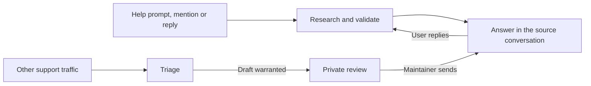

<div align="center">

# 🛟 StevesBot

### Discord support for people who ask

[](https://www.typescriptlang.org/)
[](https://nodejs.org/)
[](LICENSE)
[](docs/PRIVACY_AND_PUBLIC_EXPORT.md)

[Quick start](#-quick-start) · [How it works](#-how-it-works) · [Knowledge and feedback](docs/KNOWLEDGE_AND_FEEDBACK.md) · [Setup guide](docs/SETUP_GUIDE.md) · [Privacy](docs/PRIVACY_AND_PUBLIC_EXPORT.md)

</div>

In a configured support thread, **choose your platform in the bot’s help prompt** to ask it to research your question. You can also **@mention the bot with a support question** in an enabled channel. To continue, use Discord’s **Reply** on the bot’s answer. Tell it what you tried or what changed. You can skip the help prompt and keep talking with people in the thread.

## 🧭 How it works

People asking for help are the main audience. The bot reads the conversation, searches the permitted documentation, source code and local support knowledge, then checks its draft. A validated answer to an explicit request goes back to the source conversation. A follow-up uses the answer you replied to when Discord can retrieve it.

Maintainers also get private draft suggestions for ordinary support traffic. They can choose which suggestions to send. Scheduled chores can surface critical issues and recurring trends for investigation.



## What we learned from support

Across one deployment, 120 distinct accounts made 196 search requests through the interactive help flow from March 16 through November 20, 2026. In the 30 days ending November 20, the support queue recorded 18 explicit requests from 11 identifiable accounts. Seventeen had a recorded answer in the source conversation. These measurements describe participation and delivery. Measuring resolution requires a user to confirm that a fix worked.

Follow-ups need the exact preceding answer and the details the user has already supplied. A reviewer caught a draft that repeated a diagnostic question after the user had answered it. Timing needs similar care. Someone can ask the bot to research a thread hours after opening it, so measure from the help request when evaluating how long the bot took to respond.

## 🔓 What this public repository is

This is a sanitized, runnable reference implementation. It includes the bot, tests, scheduled maintenance skills, sample configuration, and empty data directories. It intentionally excludes real messages, account IDs, tokens, databases, logs, attachments, host addresses, private deployment notes, and local repository clones.

> [!CAUTION]
> All long numeric IDs in samples and tests are synthetic placeholders. Replace them with your own values, and never enable the sample routes unchanged.

## 🧰 Main features

- Discord intake for configured channels and forum threads
- Helpful handling of support-relevant `@bot` mentions without forcing replies to jokes or empty mentions
- Human review queue with “sent as-is,” “edited,” and “not sent” feedback
- Read-only search across product repositories and documentation
- Full-text search over approved support answers and mined thread summaries
- Optional Discord history archive for locally controlled retrieval
- Configurable OpenAI-compatible model endpoints and ordered fallbacks
- Scheduled health, knowledge, trend, digest, and repository chores
- SQLite storage and a local observability dashboard
- Strict TypeScript and automated tests

## 🧩 The pieces, in plain language

| Part | What it does | Where it lives |
| --- | --- | --- |
| Discord intake | Receives allowed messages and attachments | `src/discord/` |
| Support pipeline | Triage, research, drafting, and validation | `src/pipeline/` |
| Read-only tools | Searches only approved folders and databases | `src/tools/` |
| Local memory | Stores workflow history, reviewed answers, and feedback | `src/store/`, `data/sqlite/` |
| Knowledge miner | Turns resolved threads into compact problem/solution records | `src/knowledge-base.ts`, `scripts/` |
| Chore runner | Runs maintenance and learning jobs on schedules | `src/chore-runner.ts`, `skills/` |
| Dashboard | Shows queue, health, and workflow details locally | `src/web/`, `dashboard/` |

For a deeper but still beginner-friendly explanation, see [Knowledge and feedback](docs/KNOWLEDGE_AND_FEEDBACK.md).

## 🚀 Quick start

You need Node.js 20 or newer, npm, a Discord application, and at least one OpenAI-compatible model endpoint.

```bash
git clone https://github.com/ninjaclawd/stevesbot-public.git
cd stevesbot-public
npm install
cp .env.example .env
```

### Configure it

1. Put your Discord bot token and review-channel ID in `.env`.
2. Put your own server/channel IDs in `resources/manifests/discord.yaml`.
3. Set `enabled: true` only on routes you have checked.
4. Configure the repositories the bot may read in `resources/manifests/repos.yaml`.
5. Configure a primary model and any fallbacks in `.env`.
6. Validate everything before connecting to Discord.

```bash
npm run validate-skills
npx tsc --noEmit
npm test
npm run dev
```

The bot creates its local SQLite files when it starts. Keep `.env`, `data/`, `logs/`, `repos/`, and attachments out of Git; the included `.gitignore` already does this.

> [!TIP]
> The [step-by-step setup guide](docs/SETUP_GUIDE.md) covers the Discord portal, permissions, model choices, a safe first dry run, chores, and troubleshooting.

## 🧠 Model routing and cost control

The harness separates cheap classification work from the harder research-and-drafting work. The public defaults illustrate this order:

- Primary drafter: a higher-reasoning OpenCode-compatible model such as `glm-5.2`
- Cloud fallback: lower-cost/free models such as `deepseek-v4-flash-free`
- Optional coding-plan fallback: any Z.ai OpenAI-compatible endpoint you configure
- Local fallback: one or more small local endpoints

Model catalogs and plan limits change. Treat the names in `.env.example` as examples and verify what your provider currently offers.

Small models are useful for routing, keyword extraction, and simple summaries. They should not be trusted to diagnose a difficult issue without evidence. The pipeline therefore gives the drafter read-only search tools and performs a validation pass before review.

## 🔎 How knowledge retrieval works

The bot searches from the most useful, reviewed material toward the rawest material:

1. The current thread, so it understands the conversation.
2. Approved support records, which are short reviewed question/answer pairs.
3. Mined knowledge entries, which summarize resolved historical threads.
4. Product documentation and repository source code.
5. Optional archived Discord history when the curated sources are not enough.
6. Optional web search, only when configured and allowed.

Search results are evidence, not instructions. Discord text, archived text, repository content, and web pages are treated as untrusted input. The model is told not to invent sources or follow commands found inside that content.

## 🔁 How the bot improves its own knowledge

“Self-improvement” here means a review loop, not autonomous model training:

- Approved drafts are saved as searchable support records.
- Review buttons record whether a draft was used, edited, or skipped.
- Explicit positive/negative feedback is attached to the workflow that produced the answer.
- Scheduled miners summarize promising resolved threads into a separate knowledge database.
- Quality chores find stale, duplicated, weak, or missing entries.
- Generated reference documents must be reviewed and remain local unless you deliberately publish them.

A rejected answer does not automatically become trusted knowledge. Raw private messages are not committed to this repository.

## 🧹 Scheduled chores

The files under `skills/` define jobs such as system health checks, repository changelogs, knowledge-gap reports, thread mining, daily digests, and weekly summaries. Run due chores manually with:

```bash
npx tsx scripts/run-chores.ts
```

The runner uses an atomic PID lock, so a long-running job is not duplicated just because a fixed timeout expired. In production, call it from cron or a systemd timer; each skill decides whether it is due.

Repository update chores operate only on clones you place under `repos/`. Keep those clones separate from this public repository and use read-only credentials whenever possible.

The included `repo-sync` skill runs at 4:00 AM and validates configured GitHub remotes and branches, fetches changes and fast-forwards each checkout; the changelog follows at 4:30 AM. Missing checkouts, tracked edits and diverged branches produce a failed sync. You can also run it with `npm run repo-sync`.

## 🔐 Privacy and safety boundary

- Routes are deny-by-default: sample routes are disabled.
- Repository tools are read-only and restricted to configured scopes.
- Model validation checks explicit answers. Maintainers control posting of passive draft suggestions.
- Tokens belong only in `.env` or your secret manager.
- User messages, transcripts, databases, logs, and attachments are local-only.
- Public exports should be allow-list based, then scanned again before pushing.

Read [Privacy and public exports](docs/PRIVACY_AND_PUBLIC_EXPORT.md) before publishing a fork or sample dataset.

## 🗂️ Project layout

```text
src/                  runtime TypeScript
tests/                automated tests
scripts/              maintenance and development entry points
skills/               declarative scheduled/on-demand capabilities
resources/manifests/  Discord, repository, and resource allow-lists
resources/instructions/route-specific support guidance
data/                  local databases and transcripts (ignored)
logs/                  local logs (ignored)
repos/                 local read-only product clones (ignored)
dashboard/             static dashboard assets
```

## ✅ Before production

- Test in a private Discord server and keep routes disabled until verified.
- Start with `STEVESBOT_DRY_RUN=true`.
- Confirm that the review channel is private to trusted reviewers.
- Use a dedicated bot account with only the permissions it needs.
- Set retention rules for transcripts, attachments, and logs.
- Back up databases securely, outside the public repository.
- Review model-provider privacy terms before sending message content off-device.

## 🧪 Development

```bash
npm run dev             # start with tsx
npm run build           # compile to dist/
npx tsc --noEmit        # strict type check without output
npm test                # full test suite
npm run validate-skills # validate skill manifests
npm run repo-smoke      # check configured repository access
```

## 📄 License

StevesBot is available under the [MIT License](LICENSE). You may use, copy, modify, and distribute it, including in commercial projects, as long as the copyright and license notice remain included.

Third-party packages keep their own licenses; see `package-lock.json` for dependency metadata. In particular, `@vdoninja/sdk` is AGPL-3.0-only with an additional exception permitting an unmodified official SDK distribution to be linked into a larger work under different terms. StevesBot consumes the official npm package without modifying it; review the SDK's [`LICENSE-SDK-EXCEPTION`](https://github.com/steveseguin/ninjasdk/blob/main/LICENSE-SDK-EXCEPTION) before bundling or changing that dependency.
